# 🗺️ Roadmap — Grupo de Estudos Hands-On (CEIA/UFG)

Este é o **mapa da trilha do 1º semestre** (Fundamentos + DevOps), inspirado nos
[developer roadmaps do roadmap.sh](https://roadmap.sh/): primeiro o grafo da jornada, depois — para
cada nó — uma seção com o que se aprende, o link do lab e uma curadoria de **referências reais**
(docs oficiais em primeiro lugar, tutoriais e vídeos quando ajudam).

Como usar: siga o grafo de cima para baixo. Antes do encontro, leia o `README.md` da semana e
passe os olhos em 2 ou 3 links da seção correspondente aqui. Depois do encontro, volte aos links
que ficaram em aberto — eles são o aprofundamento que o lab (de propósito) não cabe.

> O cronograma completo, com os desafios de cada semana, está no
> [README do repositório](./README.md).

---

## 🧭 O grafo da trilha

```mermaid
flowchart TD
    subgraph FUND["Fundamentos — da máquina local à API"]
        direction TB
        S00["Semana 00<br/>Onboarding"]
        S01["Semana 01<br/>Linux, Bash e Git"]
        S02["Semana 02<br/>Web I: Redes"]
        S03["Semana 03<br/>Web II: APIs"]
        S04["Semana 04<br/>Docker"]
        S00 --> S01 --> S02 --> S03 --> S04
    end

    subgraph DEVOPS["DevOps — do CI ao serviço monitorado"]
        direction TB
        S05["Semana 05<br/>CI e Artifact Registry"]
        S06["Semana 06<br/>GCP fundamentos"]
        S07["Semana 07<br/>CD serverless"]
        S08["Semana 08<br/>Config, secrets e ambientes"]
        S09["Semana 09<br/>Logging e Monitoramento"]
        S10["Semana 10<br/>Load testing e performance"]
        S05 --> S06 --> S07 --> S08 --> S09 --> S10
    end

    subgraph DEMO["Demo Day — integração"]
        direction TB
        S11["Semana 11<br/>Demo Day"]
    end

    Start(["Início da trilha"]) --> S00
    S04 --> S05
    S10 --> S11
    S11 --> Fim(["2º semestre: planejado na retrospectiva"])

    click S00 "#semana-00--onboarding"
    click S01 "#semana-01--linux-bash-e-git"
    click S02 "#semana-02--como-a-web-funciona-i-redes"
    click S03 "#semana-03--como-a-web-funciona-ii-apis"
    click S04 "#semana-04--docker"
    click S05 "#semana-05--ci-e-artifact-registry"
    click S06 "#semana-06--gcp-fundamentos"
    click S07 "#semana-07--cd-serverless"
    click S08 "#semana-08--config-secrets-e-ambientes"
    click S09 "#semana-09--logging-e-monitoramento"
    click S10 "#semana-10--load-testing-e-performance"
    click S11 "#semana-11--demo-day"

    classDef fundamentos fill:#dbeafe,stroke:#1d4ed8,stroke-width:1px,color:#1e3a8a
    classDef devops fill:#dcfce7,stroke:#15803d,stroke-width:1px,color:#14532d
    classDef demoday fill:#fef3c7,stroke:#b45309,stroke-width:1px,color:#78350f
    classDef marco fill:#f1f5f9,stroke:#64748b,stroke-width:1px,color:#0f172a

    class S00,S01,S02,S03,S04 fundamentos
    class S05,S06,S07,S08,S09,S10 devops
    class S11 demoday
    class Start,Fim marco
```

> Se o seu visualizador não renderizar os cliques do grafo, use o índice abaixo — cada nó tem uma
> seção própria neste arquivo.

---

## Semana 00 — Onboarding

O encontro que deixa o ambiente pronto: conta e créditos no GCP, terminal funcionando (WSL no
Windows), Docker instalado, Git/GitHub configurado e Discord no ar. Nada de teoria — é tudo
instalação, acesso e um hello world no fim.

📁 Lab: [`./semana-00/`](./semana-00/)

**Referências**

- [Google Cloud — Free tier e créditos iniciais](https://cloud.google.com/free)
- [Google Cloud for Education](https://cloud.google.com/edu)
- [Instalar o WSL (Microsoft Learn)](https://learn.microsoft.com/windows/wsl/install)
- [Docker Desktop — instalação](https://docs.docker.com/desktop/)
- [GitHub Docs — Quickstart (criar conta, repo e primeiro commit)](https://docs.github.com/en/get-started/quickstart)
- [Discord — Guia para iniciantes](https://support.discord.com/hc/en-us/articles/360045138571-Beginner-s-Guide-to-Discord)

---

## Semana 01 — Linux, Bash e Git

Sobreviver (e ser produtivo) no terminal: navegação, permissões, pipes, redirecionamento, SSH e
scripts que automatizam o chato. Do lado do Git, o fluxo que vai ser usado o semestre inteiro:
branch → commit → push → pull request.

📁 Lab: [`./semana-01/`](./semana-01/)

**Referências**

- [The Missing Semester of Your CS Education (MIT)](https://missing.csail.mit.edu/)
- [GNU Bash Reference Manual](https://www.gnu.org/software/bash/manual/bash.html)
- [Bash Guide for Beginners (TLDP)](https://tldp.org/LDP/Bash-Beginners-Guide/html/)
- [OpenSSH — manual pages](https://www.openssh.org/manual.html)
- [GitHub Docs — Conectar ao GitHub com SSH](https://docs.github.com/en/authentication/connecting-to-github-with-ssh)
- [Pro Git (livro completo, em português)](https://git-scm.com/book/pt-br/v2)
- [roadmap.sh — Linux](https://roadmap.sh/linux)

---

## Semana 02 — Como a web funciona I (Redes)

O caminho de um request: o que acontece entre digitar uma URL e receber bytes de volta. DNS,
TCP/IP, portas, modelo cliente-servidor, HTTP e HTTPS — o vocabulário que todas as semanas
seguintes assumem como dado.

📁 Lab: [`./semana-02/`](./semana-02/)

**Referências**

- [MDN — How the Web works](https://developer.mozilla.org/en-US/docs/Learn/Getting_started_with_the_web/How_the_Web_works)
- [MDN — HTTP (referência e guias)](https://developer.mozilla.org/en-US/docs/Web/HTTP)
- [Cloudflare Learning — O que é DNS?](https://www.cloudflare.com/learning/dns/what-is-dns/)
- [Cloudflare Learning — Modelo OSI](https://www.cloudflare.com/learning/ddos/glossary/open-systems-interconnection-model-osi/)
- [Cloudflare Learning — TCP/IP](https://www.cloudflare.com/learning/ddos/glossary/tcp-ip/)
- [High Performance Browser Networking (livro online, O'Reilly)](https://hpbn.co/)

---

## Semana 03 — Como a web funciona II (APIs)

Da rede para a aplicação: o que é uma API REST, como se desenha um recurso, JSON como formato de
troca, status codes que dizem a verdade e TLS/HTTPS. No lab, a primeira API de verdade do
semestre com FastAPI.

📁 Lab: [`./semana-03/`](./semana-03/)

**Referências**

- [MDN — Glossário: REST](https://developer.mozilla.org/en-US/docs/Glossary/REST)
- [MDN — HTTP response status codes](https://developer.mozilla.org/en-US/docs/Web/HTTP/Status)
- [FastAPI — Tutorial oficial](https://fastapi.tiangolo.com/tutorial/)
- [JSON — introdução oficial (em português)](https://www.json.org/json-pt.html)
- [OpenAPI Specification (Swagger)](https://swagger.io/specification/)
- [Cloudflare Learning — O que é HTTPS?](https://www.cloudflare.com/learning/ssl/what-is-https/)

---

## Semana 04 — Docker

Empacotar a aplicação com tudo que ela precisa para rodar: imagem, container, `Dockerfile`,
camadas e cache, volumes, networks e orquestração local com Compose. É a fundação de tudo que
vem depois — CI, registry e Cloud Run só consomem imagens.

📁 Lab: [`./semana-04/`](./semana-04/)

**Referências**

- [Docker Docs — Get started](https://docs.docker.com/get-started/)
- [Docker Docs — Dockerfile reference](https://docs.docker.com/reference/dockerfile/)
- [Docker Docs — Building best practices](https://docs.docker.com/build/building/best-practices/)
- [Docker Docs — Docker Compose](https://docs.docker.com/compose/)
- [Docker Docs — Workshop: build and share a containerized application](https://docs.docker.com/get-started/workshop/)
- [Docker Curriculum (tutorial guiado)](https://docker-curriculum.com/)

---

## Semana 05 — CI e Artifact Registry

Automatizar o que antes era manual: a cada push, o GitHub Actions roda lint e testes, constrói a
imagem e publica uma versão no Artifact Registry do GCP. Aqui aparece também a autenticação entre
GitHub e Google Cloud.

📁 Lab: [`./semana-05/`](./semana-05/)

**Referências**

- [GitHub Actions — documentação oficial](https://docs.github.com/en/actions)
- [GitHub Actions — Building and testing Python](https://docs.github.com/en/actions/automating-builds-and-tests/building-and-testing-python)
- [Artifact Registry — documentação](https://cloud.google.com/artifact-registry/docs)
- [`google-github-actions/auth` (autenticação GitHub → GCP)](https://github.com/google-github-actions/auth)
- [Ruff — linter e formatter para Python](https://docs.astral.sh/ruff/)
- [pytest — documentação oficial](https://docs.pytest.org/en/stable/)

---

## Semana 06 — GCP fundamentos

O mapa do Google Cloud: projetos e hierarquia de recursos, IAM (quem pode o quê), a CLI `gcloud`,
e a decisão que volta sempre — Cloud Run (serverless) ou Compute Engine (VM). Também é a semana em
que os alertas de orçamento são ligados.

📁 Lab: [`./semana-06/`](./semana-06/)

**Referências**

- [Google Cloud — Hierarquia de recursos (organização, pastas, projetos)](https://cloud.google.com/resource-manager/docs/cloud-platform-resource-hierarchy)
- [IAM — visão geral](https://cloud.google.com/iam/docs/overview)
- [gcloud CLI — documentação](https://cloud.google.com/sdk/docs)
- [gcloud CLI — cheat sheet](https://cloud.google.com/sdk/docs/cheatsheet)
- [Cloud Run — documentação](https://cloud.google.com/run/docs)
- [Compute Engine — documentação](https://cloud.google.com/compute/docs)
- [Cloud Billing — criar orçamentos e alertas](https://cloud.google.com/billing/docs/how-to/budgets)

---

## Semana 07 — CD serverless

Fechar o ciclo: o merge na `main` dispara build, push da imagem e deploy automático no Cloud Run.
Entram no caminho os conceitos de revisão, divisão de tráfego e rollback — e o primeiro URL
público de verdade.

📁 Lab: [`./semana-07/`](./semana-07/)

**Referências**

- [Cloud Run — Continuous deployment a partir do Git](https://cloud.google.com/run/docs/continuous-deployment-with-cloud-build)
- [`google-github-actions/deploy-cloudrun`](https://github.com/google-github-actions/deploy-cloudrun)
- [Cloud Run — Implantar imagens de container](https://cloud.google.com/run/docs/deploying)
- [Cloud Run — Rollouts, rollbacks e migração de tráfego](https://cloud.google.com/run/docs/rollouts-rollbacks-traffic-migration)
- [Cloud Run — Variáveis de ambiente](https://cloud.google.com/run/docs/configuring/services/environment-variables)
- [GitHub Docs — About continuous deployment](https://docs.github.com/en/actions/deployment/about-deployments/about-continuous-deployment)

---

## Semana 08 — Config, secrets e ambientes

Tirar configuração e credencial de dentro do código: variáveis de ambiente, Secret Manager,
separação entre staging e produção e health checks que dizem se o serviço está mesmo de pé. É a
semana que impede o acidente clássico de commitar uma chave.

📁 Lab: [`./semana-08/`](./semana-08/)

**Referências**

- [Secret Manager — documentação](https://cloud.google.com/secret-manager/docs)
- [Cloud Run — Usar secrets em um serviço](https://cloud.google.com/run/docs/configuring/services/secrets)
- [The Twelve-Factor App — III. Configurações (em português)](https://12factor.net/pt_br/config)
- [Cloud Run — Health checks (startup e liveness probes)](https://cloud.google.com/run/docs/configuring/healthchecks)
- [Pydantic Settings — configuração tipada em Python](https://docs.pydantic.dev/latest/concepts/pydantic_settings/)
- [GitHub Actions — Usar secrets em workflows](https://docs.github.com/en/actions/security-guides/using-secrets-in-github-actions)

---

## Semana 09 — Logging e Monitoramento

Saber o que o serviço está fazendo quando ninguém está olhando: logs estruturados, métricas,
dashboards e alertas. A régua conceitual vem do SRE book — os quatro sinais dourados e o que vale
a pena acordar alguém de madrugada.

📁 Lab: [`./semana-09/`](./semana-09/)

**Referências**

- [Cloud Logging — documentação](https://cloud.google.com/logging/docs)
- [Cloud Logging — Logs estruturados](https://cloud.google.com/logging/docs/structured-logging)
- [Cloud Monitoring — documentação](https://cloud.google.com/monitoring/docs)
- [Cloud Monitoring — Alerting](https://cloud.google.com/monitoring/alerts)
- [Prometheus — visão geral](https://prometheus.io/docs/introduction/overview/)
- [Grafana — documentação](https://grafana.com/docs/grafana/latest/)
- [Google SRE Book — Monitoring Distributed Systems](https://sre.google/sre-book/monitoring-distributed-systems/)

---

## Semana 10 — Load testing e performance

Descobrir onde o serviço quebra antes que o usuário descubra: throughput, latência (e por que a
média mente), concorrência e autoscaling. O lab compara o custo e o desempenho do Cloud Run com
as máquinas 4090 do laboratório.

📁 Lab: [`./semana-10/`](./semana-10/)

**Referências**

- [Locust — documentação](https://docs.locust.io/en/stable/)
- [k6 — documentação (Grafana)](https://grafana.com/docs/k6/latest/)
- [k6 — Tipos de teste de carga (smoke, stress, soak)](https://grafana.com/docs/k6/latest/testing-guides/test-types/)
- [Cloud Run — Autoscaling de instâncias](https://cloud.google.com/run/docs/about-instance-autoscaling)
- [Cloud Run — Concorrência por instância](https://cloud.google.com/run/docs/configuring/concurrency)
- [Google SRE Workbook — Implementing SLOs](https://sre.google/workbook/implementing-slos/)
- [Gil Tene — "How NOT to Measure Latency" (vídeo)](https://www.youtube.com/watch?v=lJ8ydIuPFeU)

---

## Semana 11 — Demo Day

A integração de tudo: um serviço de análise de sentimento com CI/CD, rodando no GCP, com config
gerenciada, logs e alertas — apresentado para a turma e revisado pelos colegas. Além do código,
conta o README: ele é o que sobra no portfólio.

📁 Lab: [`./semana-11/`](./semana-11/)

**Referências**

- [Google Cloud — MLOps: continuous delivery e pipelines de automação em ML](https://cloud.google.com/architecture/mlops-continuous-delivery-and-automation-pipelines-in-machine-learning)
- [Google — Rules of Machine Learning (boas práticas de engenharia de ML)](https://developers.google.com/machine-learning/guides/rules-of-ml)
- [Hidden Technical Debt in Machine Learning Systems (NeurIPS 2015)](https://proceedings.neurips.cc/paper/2015/hash/86df7dcfd896fcaf2674f757a2463eba-Abstract.html)
- [Made With ML — curso de MLOps end-to-end](https://madewithml.com/)
- [Make a README (estrutura de um bom README)](https://www.makeareadme.com/)
- [Awesome README (coleção de exemplos)](https://github.com/matiassingers/awesome-readme)

---

## 🧩 Roadmaps de referência

A trilha deste grupo é uma versão enxuta e hands-on de roadmaps já consolidados da comunidade.
Quando quiser ir além das 12 semanas — ou entender onde cada tema se encaixa no quadro maior —
use estes mapas como bússola:

- [roadmap.sh — DevOps](https://roadmap.sh/devops) — a espinha dorsal das Semanas 04 a 10:
  Linux, redes, containers, CI/CD, cloud, observabilidade.
- [roadmap.sh — MLOps](https://roadmap.sh/mlops) — para onde a trilha caminha: versionamento de
  dados e modelos, pipelines de treino, serving e monitoramento de modelos.
- [roadmap.sh — Backend](https://roadmap.sh/backend) — aprofunda as Semanas 02 e 03: HTTP, APIs,
  bancos de dados, autenticação, caching.
- [roadmap.sh — Frontend](https://roadmap.sh/frontend) — o outro lado do cliente-servidor; útil
  para quem quiser colocar uma interface no serviço do Demo Day.

Os roadmaps são mapas de território, não listas de tarefas: ninguém completa um inteiro. Use-os
para escolher o próximo passo, não para medir o quanto falta.
